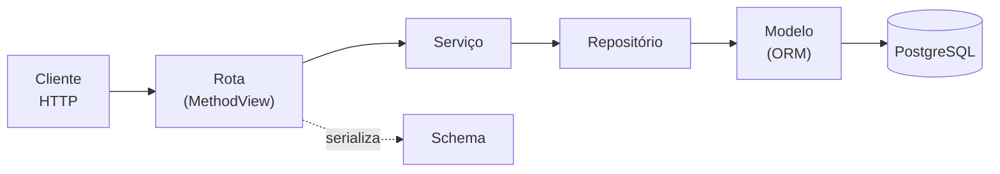
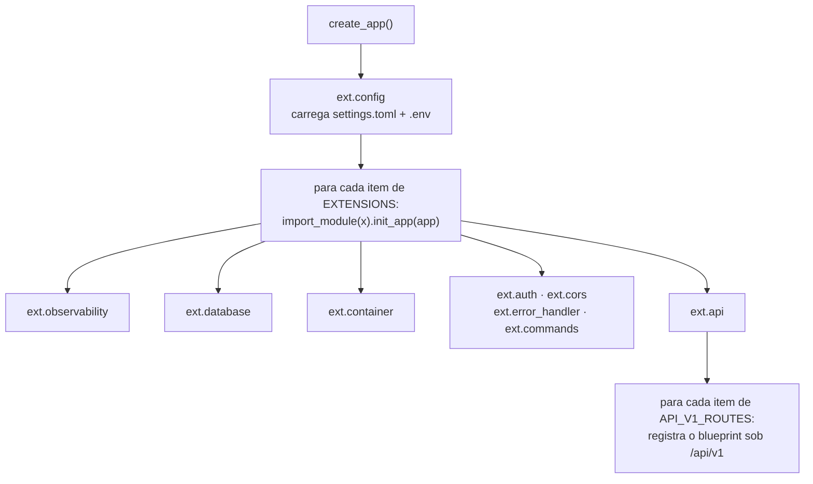

# Arquitetura

## Os dois eixos

A arquitetura tem **duas** dimensões independentes. Confundi-las é a origem da maior parte
da confusão em projetos assim.

**Eixo vertical — por onde a requisição passa.** Quatro camadas, cada uma conhecendo
apenas a de baixo:



**Eixo horizontal — como a aplicação é montada.** Acontece uma única vez, na
inicialização. O `create_app()` não conhece nenhuma extensão nem nenhuma rota: ele lê duas
listas de caminhos de módulo do `settings.toml` e importa cada uma.



A consequência prática: **nenhuma funcionalidade nova exige editar `app.py`.** Você cria um
módulo e acrescenta uma linha na configuração.

---

## As camadas

A coluna mais importante é a última. É ela que impede a arquitetura de se dissolver com o
tempo.

| Camada | Pasta | Responsabilidade | **Não pode** |
|---|---|---|---|
| **Rota** | `app/blueprint/restapi/v1/` | Traduzir HTTP em chamada de serviço. Validar entrada por schema, devolver a saída. | Montar consulta, conter regra de negócio, usar `try/except` para erro de domínio |
| **Serviço** | `app/service/` | Regra de negócio, validação semântica, ownership, controle de transação. | Tocar no ORM direto, saber o que é HTTP (status, header, request) |
| **Repositório** | `app/repository/` | Única camada que monta SQL. Traduz intenção em consulta. | Conter regra de negócio ou decidir permissão |
| **Modelo** | `app/domain/` | Mapear tabela para classe. Colunas e relacionamentos. | Conter comportamento de negócio |
| **Schema** | `app/schemas/` | Único contrato de entrada e saída da API. Valida e serializa. | Acessar banco |

E a infraestrutura, fora do caminho da requisição:

| Módulo | Papel |
|---|---|
| `app/ext/` | Extensões. **Cada módulo expõe exatamente uma função `init_app(app)`** — é essa convenção que permite o carregador tratá-las de forma uniforme. |
| `app/http_errors.py` | Envelope de erro e o mapa exceção → status HTTP. Fica fora de `ext/` porque é usado por duas extensões diferentes; se morasse em uma delas, a outra passaria a depender dela. |
| `app/request_context.py` | Id da requisição. Módulo folha: não importa nada do projeto, então pode ser usado por qualquer camada sem criar ciclo. |
| `app/authz.py` | Papéis, permissões e o mapa entre eles. Módulo folha, pelo mesmo motivo: o modelo grava o papel, a extensão decide com ele, a rota declara a permissão que exige e o schema publica as do usuário. |

---

## Regras de dependência

```
rota      →  serviço, schema, ext
serviço   →  repositório, domínio
repositório → domínio, ext.database
domínio   →  (nada do projeto)
schema    →  (nada do projeto)
```

Duas regras que valem a pena memorizar:

1. **Nenhuma extensão importa outra extensão.** Se duas precisam da mesma coisa, essa coisa
   vira um módulo neutro na raiz de `app/` (foi o caso de `http_errors.py`).
2. **A seta nunca aponta para cima.** Serviço não importa rota, repositório não importa
   serviço. Se você sentir essa necessidade, a lógica está na camada errada.

Os **módulos folha** da raiz de `app/` (`authz.py`, `request_context.py`) são a exceção
prevista pela regra 1: como não importam nada do projeto, qualquer camada pode importá-los
sem criar ciclo nem acoplar duas camadas uma à outra. É o que permite rota, serviço,
modelo e schema falarem do mesmo vocabulário de permissões.

---

## As peças genéricas

Quase todo o CRUD já está escrito. Uma entidade nova herda:

| Classe | Arquivo | O que já dá de graça |
|---|---|---|
| `BaseModel` | `app/domain/base.py` | `id`, `created_at`, `last_update`, `deleted`, convenção de nomes de restrição |
| `BaseRepository[T]` | `app/repository/base_repository.py` | `get_by_id`, `get_by_filter`, `get_first_by_filter`, `get_page`, `add`, `update`, `soft_delete`, `commit`, `rollback` |
| `BaseService[T]` | `app/service/base_service.py` | CRUD completo, ownership, exclusão lógica, transação, os ganchos `before_create` / `before_update` / `before_delete` e o `_clean_text` que eles usam para normalizar texto |

O parâmetro de tipo (`BaseRepository[Item]`) é o que faz o type checker saber que
`get_by_id()` devolve `Item | None`, e não `BaseModel | None`.

---

## Quatro mecanismos que convém entender antes de mexer

### Autorização

Uma **permissão** é uma capacidade (`item:escrever`). Um **papel** é um pacote nomeado de
permissões, e é o papel que fica gravado em `users.role`. Os dois ficam em `app/authz.py`,
junto do mapa entre eles:

```python
#: Cada papel parte do anterior, para que a hierarquia esteja escrita no código.
_LEITOR  = frozenset({ITEM_LER})
_USUARIO = _LEITOR  | {ITEM_ESCREVER}
_GERENTE = _USUARIO | {ITEM_LER_DE_TODOS}
_ADMIN   = _GERENTE | {ITEM_ESCREVER_DE_TODOS}

ROLE_PERMISSIONS = {
    Role.LEITOR: _LEITOR,
    Role.USUARIO: _USUARIO,
    Role.GERENTE: _GERENTE,
    Role.ADMIN: _ADMIN,
}
```

Os quatro papéis que acompanham a base vão do somente-leitura ao administrador. O
`leitor` existe por um motivo prático: sem um papel sem permissão de escrita, a resposta
**403** só seria alcançável remendando o mapa dentro do teste, e a configuração que
acompanha a base não demonstraria o próprio caminho de negação.

A rota declara a **permissão** que exige, nunca o papel:

```python
class ItemView(MethodView):
    decorators = [permission_required(Permission.ITEM_LER)]   # piso do recurso

    @permission_required(Permission.ITEM_ESCREVER)            # o método exige mais
    def post(self, payload): ...
```

Três consequências que valem o espaço:

* **A hierarquia é inclusão de conjuntos, não um número.** `ADMIN` contém `GERENTE`, que
  contém `USUARIO`, que contém `LEITOR`. Nenhum peso arbitrário para justificar, e "o
  gerente vê tudo mas altera só o que é dele" é expressável — o que um nível ordenado não
  permitiria.
* **O papel mora só no banco.** Não há claim equivalente no token: a autorização lê
  `current_user.role`, da linha que o `user_lookup_loader` já carregou. Trocar o papel vale
  na requisição seguinte, com o mesmo token.
* **Quem decide é uma declaração, não um `if`.** Mudar quem pode fazer o quê é reescrever
  o mapa, não caçar verificações espalhadas pelas rotas.

### Ownership

A permissão responde "pode fazer esta operação?"; o ownership responde "sobre **este**
registro?". São perguntas diferentes e têm respostas HTTP diferentes.

Entidades marcadas com `owned=True` pertencem a um usuário. O **escopo de dono** é
parâmetro de cada método do serviço, não do construtor — e **não tem valor padrão**:

```python
service.get_by_id(item_id, current_owner_scope(Permission.ITEM_LER_DE_TODOS))
```

`current_owner_scope(permissão)` (em `app/ext/auth.py`) devolve o id do usuário logado, ou
a sentinela `ANY_OWNER` se o papel dele tiver a permissão de escopo informada. É o
**único** lugar onde o filtro de posse é dispensado, e a permissão vem explícita no ponto
de chamada para que a rota diga *de quem* ela opera sem precisar abrir o `auth.py`.

Ler e escrever têm permissões de escopo separadas (`ITEM_LER_DE_TODOS`,
`ITEM_ESCREVER_DE_TODOS`), que é o que permite o papel que enxerga tudo e altera só o
próprio.

| Situação | Resposta |
|---|---|
| O papel não tem a permissão da operação | **403** — decidido antes de tocar em dado algum, não revela nada |
| Tem a permissão, mas o recurso é de outro dono | **404** — um 403 confirmaria que o recurso existe |

### Erros

A rota não trata erro. O serviço levanta uma exceção de `app/service/errors.py`, e o mapa
`ERROR_STATUS` em `app/http_errors.py` a traduz em status:

| Exceção | Status |
|---|---|
| `NotFoundError` | 404 |
| `ConflictError` | 409 |
| `BusinessRuleError` | 422 |
| `PermissionDeniedError` | 403 |
| `AuthenticationError` | 401 |

Toda resposta de erro tem o mesmo formato, com o `request_id` que também aparece no log:

```json
{ "code": 404, "status": "Not Found",
  "message": "Item não encontrado.", "request_id": "a3f1c9..." }
```

A exceção é o 422 de validação: quem o monta é o próprio flask-smorest, que acrescenta
`errors` com o detalhe por campo e não passa pelo `error_response` — por isso ele não traz
`request_id`. `schemas/error_schema.py` documenta o envelope inteiro, `errors` incluído, e
`tests/test_contracts.py` reprova se o schema e o código divergirem.

### Segurança das rotas

A exigência de token é declarada **globalmente** no spec OpenAPI (`app/ext/api.py`) e
aplicada por classe (`decorators = [permission_required(...)]`, que implica o token). Rota
que qualquer autenticado acessa usa `authenticated` — o `permission_required()` sem
argumentos, nomeado em `app/ext/auth.py`. Rotas públicas abrem mão explicitamente com
`@blp.doc(security=PUBLIC)`.

A direção é deliberada: **esquecer a anotação fecha a rota, não abre** — um método novo
sem decorator herda o piso da classe. E esquecer de declarar a permissão reprova em
`tests/test_contracts.py`, que varre as rotas registradas atrás de operação protegida sem
permissão declarada. O mesmo arquivo guarda a lista das rotas públicas (`ROTAS_PUBLICAS`):
abrir uma rota exige acrescentá-la ali, então abrir sem querer também reprova.

---

## Mapa de arquivos

```
app/
  app.py                     create_app() — não conhece nenhuma extensão
  http_errors.py             envelope de erro + mapa exceção → HTTP
  request_context.py         id da requisição (módulo folha)
  authz.py                   papéis, permissões e o mapa entre eles (módulo folha)
  ext/
    config.py                Dynaconf + carregador dinâmico de módulos
    database.py              instância do SQLAlchemy
    container.py             container de injeção de dependência
    api.py                   flask-smorest + blueprint /api/v1 + segurança global
    auth.py                  JWT, decorator de permissão, escopo de ownership
    observability.py         request id + nível de log
    cors.py                  origens permitidas
    error_handler.py         registra os handlers a partir do mapa
    commands.py              comandos `flask ...`
  domain/
    base.py                  BaseModel (campos de controle, convenção de nomes)
    models.py                User, Item
  repository/
    base_repository.py       CRUD genérico
    user_repository.py       uma linha: amarra o modelo
    item_repository.py
  service/
    base_service.py          CRUD + ownership + ganchos
    errors.py                exceções de domínio
    pagination.py            dataclass Page
    auth_service.py          verificação de credenciais
    user_service.py
    item_service.py
  schemas/
    pagination_schema.py     parâmetros e envelope de paginação
    error_schema.py          envelope de erro (documentação)
    health_schema.py
    auth_schema.py
    item_schema.py
  blueprint/restapi/v1/
    health.py                sonda de disponibilidade (pública)
    auth.py                  token e identidade
    item.py                  CRUD da entidade de exemplo

migrations/                  Alembic
tests/                       pytest
docker/                      entrypoint e init do banco
settings.toml                configuração (sem segredos) + as duas listas de módulos
requirements.lock.txt        versões exatas do build (versionado)
```

> **Invariante do layout:** `app/` é a raiz do `sys.path` — os imports são
> `from ext import ...`, não `from app.ext import ...`. Esse fato está codificado em cinco
> lugares: `pythonpath` do pytest e `src` do ruff (`pyproject.toml`), `PYTHONPATH` do
> `Dockerfile`, `sys.path.insert` do `migrations/env.py`, e `python.analysis.extraPaths`
> do `.vscode/settings.json`. Mudar o layout exige atualizar os cinco.
